# Secure Web System as an Enterprise Risk Control

Sistema web con frontend React, autenticación con Auth0, una API Spring Boot (Java 21) protegida como OAuth 2.0 Resource Server y publicación por HTTPS con Duck DNS, Apache HTTP Server y un certificado de Let's Encrypt.

**URL desplegada:** <https://daniel-risk-lab.duckdns.org>

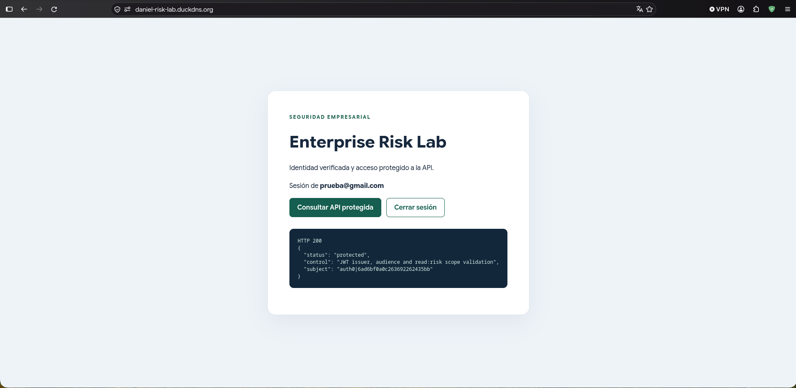

## Arquitectura

```
Navegador
  │ login y access token
  ▼
Auth0 ───────────────► React (Vite) ── Authorization: Bearer <token> ──► Spring Boot API
                                                                         │ 127.0.0.1:8080
Internet ── Duck DNS ── Apache + TLS (80 → 443) ── ProxyPass /api/ ──────┘
```

| Componente | Implementación |
| --- | --- |
| Servidor | AWS EC2 `t3.micro`, Amazon Linux 2023, IP pública `54.221.66.193` |
| DNS | `daniel-risk-lab.duckdns.org` → IP pública de la instancia |
| Web y TLS | Apache 2.4 con `mod_ssl`, certificado Let's Encrypt (cadena ISRG, TLS 1.3) y redirección HTTP → HTTPS |
| Frontend | Build estático de Vite en `/var/www/enterprise-risk-frontend` |
| Backend | JAR de Spring Boot 4.1 como servicio systemd `enterprise-risk-api`, usuario sin privilegios `riskapi`, escuchando solo en `127.0.0.1:8080` |
| Identidad | Tenant de Auth0, API `https://enterprise-risk-api` (RS256) con permiso `read:risk` |

## Estructura del repositorio

- [`frontend/`](frontend/): React + Vite + `@auth0/auth0-react`; login, logout y llamada con Bearer token.
- [`backend/`](backend/): API Spring Boot; valida firma RS256, emisor, audiencia, expiración y el permiso `read:risk`.
- [`deploy/`](deploy/): virtual host de Apache (Ubuntu y Amazon Linux), unidad systemd y plantilla de variables del servidor.
- [`docs/DEPLOYMENT.md`](docs/DEPLOYMENT.md): guía de configuración de Auth0 y despliegue.
- [`docs/EVALUATION.md`](docs/EVALUATION.md): checklist del enunciado con la evidencia de cada punto.
- [`docs/evidence/`](docs/evidence/): salidas de comandos y capturas.

## Evidencias

| Requisito | Evidencia |
| --- | --- |
| Llamada autenticada exitosa (HTTPS) | [17-https-api-200.png](docs/evidence/screenshots/17-https-api-200.png) |
| Certificado válido | [certificate.txt](docs/evidence/certificate.txt) (`Verify return code: 0 (ok)`, emitido por Let's Encrypt, vence 2027-01-18) |
| 401 sin token | [unauthenticated.txt](docs/evidence/unauthenticated.txt) |
| HTTP redirige a HTTPS | [http-redirect.txt](docs/evidence/http-redirect.txt) |
| Puerto 8080 no accesible desde Internet | [port-8080.txt](docs/evidence/port-8080.txt) |
| Renovación del certificado | [18-certbot-renew-dry-run.png](docs/evidence/screenshots/18-certbot-renew-dry-run.png) |
| Logs centrales del servicio | [19-journalctl-service-logs.png](docs/evidence/screenshots/19-journalctl-service-logs.png) |
| Pruebas automatizadas del backend | [local-tests.txt](docs/evidence/local-tests.txt) (13 pruebas, 0 fallos) |

<details>
<summary>Configuración de Auth0</summary>

| | |
| --- | --- |
| API con identificador `https://enterprise-risk-api` | 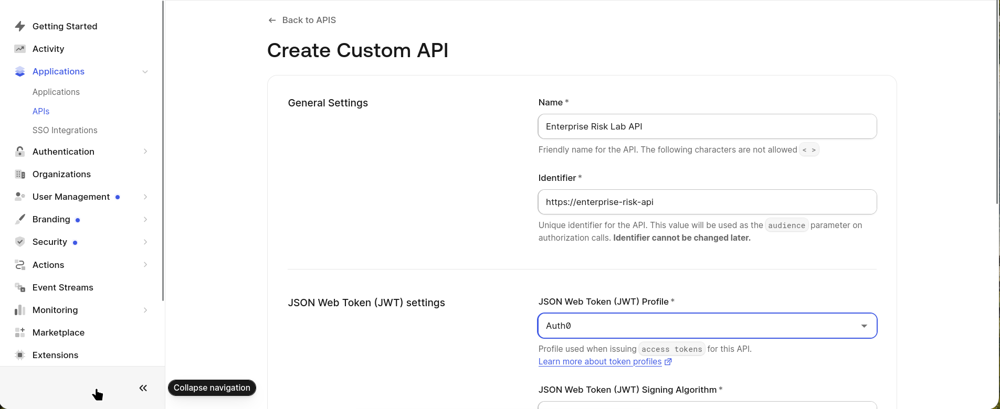 |
| Firma RS256 | 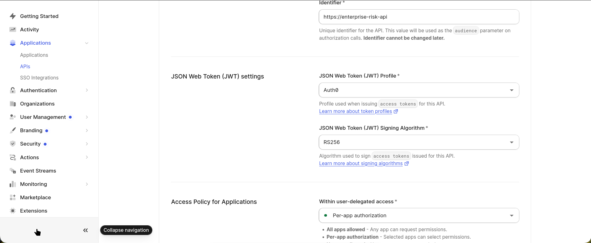 |
| Permiso `read:risk` | 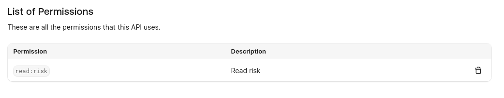 |
| SPA con User-Delegated Access a la API | 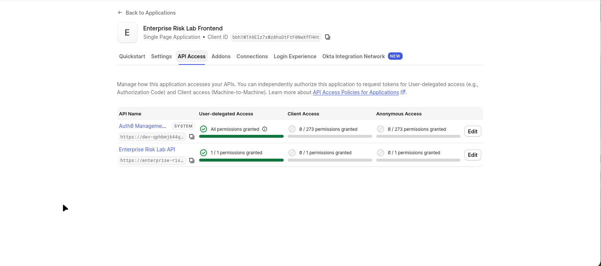 |
| Login universal de Auth0 | 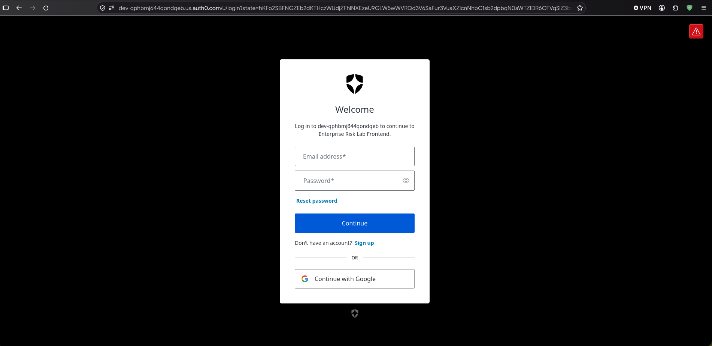 |

</details>

<details>
<summary>Infraestructura y flujo en HTTPS</summary>

| | |
| --- | --- |
| Instancia EC2 | 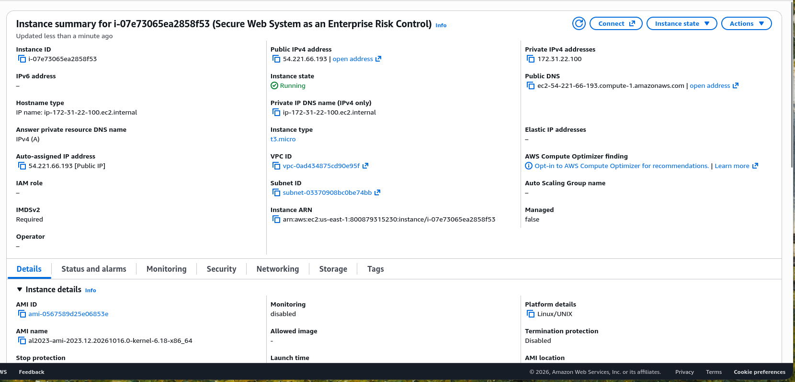 |
| Duck DNS apuntando a la instancia | 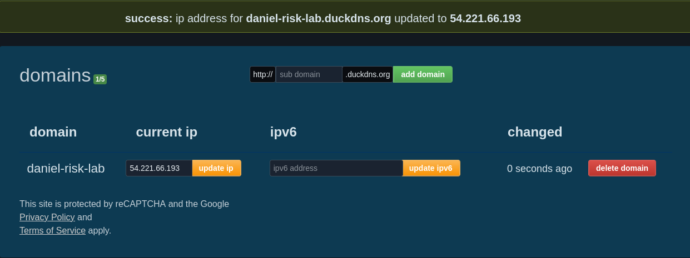 |
| Pantalla de inicio en HTTPS | 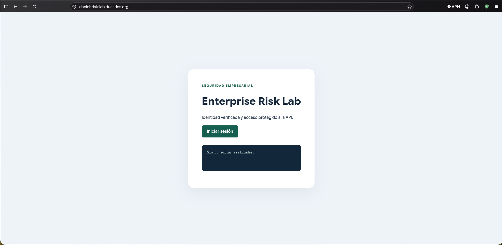 |
| Sesión iniciada en HTTPS |  |

</details>

<details>
<summary>Flujo local</summary>

| | |
| --- | --- |
| Sesión iniciada en `localhost:5173` | 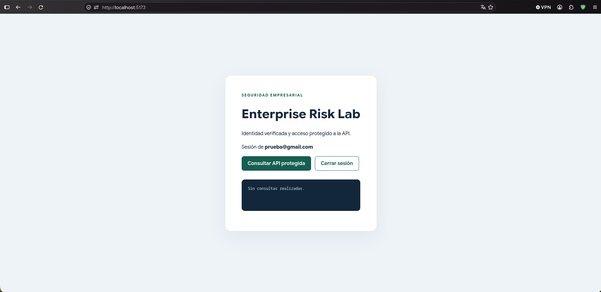 |
| Respuesta 200 en local | 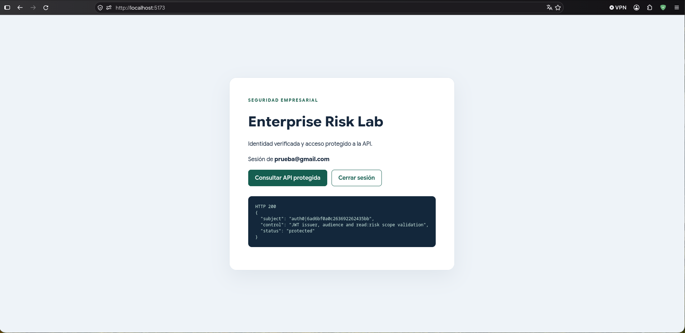 |

</details>

## Ejecución local

Requisitos: Java 21, Node 20.19+ o 22.12+, npm y un tenant de Auth0 configurado según [DEPLOYMENT.md](docs/DEPLOYMENT.md).

1. Copia `frontend/.env.example` a `frontend/.env.local` y reemplaza dominio y Client ID.
2. Crea `backend/.env` con `AUTH0_ISSUER_URI`, `AUTH0_JWK_SET_URI` y `AUTH0_AUDIENCE` (formato `CLAVE=valor`, ver [`deploy/backend.env.example`](deploy/backend.env.example)). Ninguno de los dos archivos se versiona.
3. Backend:

```bash
cd backend
./mvnw spring-boot:run
```

4. Frontend, en otra terminal:

```bash
cd frontend
npm ci
npm run dev
```

Abre `http://localhost:5173`. Sin valores reales de Auth0 la página muestra "Configuración pendiente".

```bash
curl -i http://127.0.0.1:8080/api/risk-status   # 401
curl -i http://127.0.0.1:8080/actuator/health   # 200
```

## Pruebas y compilación

```bash
cd backend && ./mvnw clean verify
cd ../frontend && npm ci && npm run build
```

Las pruebas de integración levantan la API con un servidor JWKS local y JWT firmados con claves RSA temporales. Cubren: sin token (401), token malformado (401), token válido (200), sin permiso `read:risk` (403), emisor incorrecto (401), audiencia incorrecta (401), token vencido (401), firma inválida (401), health público (200), otras rutas denegadas (403) y CORS (origen permitido 200, no permitido 403).

## Autenticación vs. autorización

**Autenticación** responde a quién es el usuario: Auth0 verifica las credenciales y emite un access token firmado. **Autorización** responde a qué puede hacer: la API exige que ese token traiga el permiso `read:risk`. Por eso un token ausente o inválido recibe **401**, mientras que un token válido sin el permiso recibe **403**. El backend va un paso más allá del enunciado, que solo pedía `authenticated()`.

## Controles y riesgos

| Control | Riesgo reducido | Evidencia |
| --- | --- | --- |
| Autenticación con Auth0 | Suplantación y manejo inseguro de credenciales | Login universal de Auth0; la contraseña nunca pasa por la aplicación |
| Validación de JWT en la API | Acceso no autorizado a la API | 401 sin token, con firma inválida o vencido |
| Validación de emisor y audiencia | Reutilización de tokens de otro tenant o destinados a otra API | Pruebas negativas 401 |
| Permiso `read:risk` | Usuario autenticado sin autorización para la operación | 403 sin permiso, 200 con permiso |
| HTTPS con certificado válido | Exposición de credenciales o tokens en tránsito | `certificate.txt`, redirección 301 y renovación de prueba exitosa |
| Proxy inverso Apache + escucha en loopback | Exposición directa del puerto de la aplicación | Solo 80 y 443 públicos; 8080 agota el tiempo desde Internet |
| Logs centrales del servicio | Investigación tardía de incidentes | `journalctl -u enterprise-risk-api` con evento `risk_status_read`; access logs sin tokens |

## Notas de seguridad

- El frontend solo contiene dominio, Client ID y audiencia; no hay client secret.
- El SDK de Auth0 mantiene los tokens en memoria. La aplicación no los muestra, no los registra y no los guarda manualmente.
- CORS permite exactamente `http://localhost:5173` y el origen de producción, y solo el método `GET`.
- CSRF está deshabilitado porque la API no usa sesión ni cookies; la autenticación es con Bearer token.
- El servicio systemd corre con un usuario de sistema, `NoNewPrivileges`, `ProtectSystem=strict` y `ProtectHome`.
- `.env*`, claves y certificados están en `.gitignore`.

## Referencias

- [Auth0 React SDK](https://auth0.com/docs/libraries/auth0-react)
- [Spring Security: JWT Resource Server](https://docs.spring.io/spring-security/reference/servlet/oauth2/resource-server/jwt.html)
- [Certbot](https://eff-certbot.readthedocs.io/en/stable/using.html)
